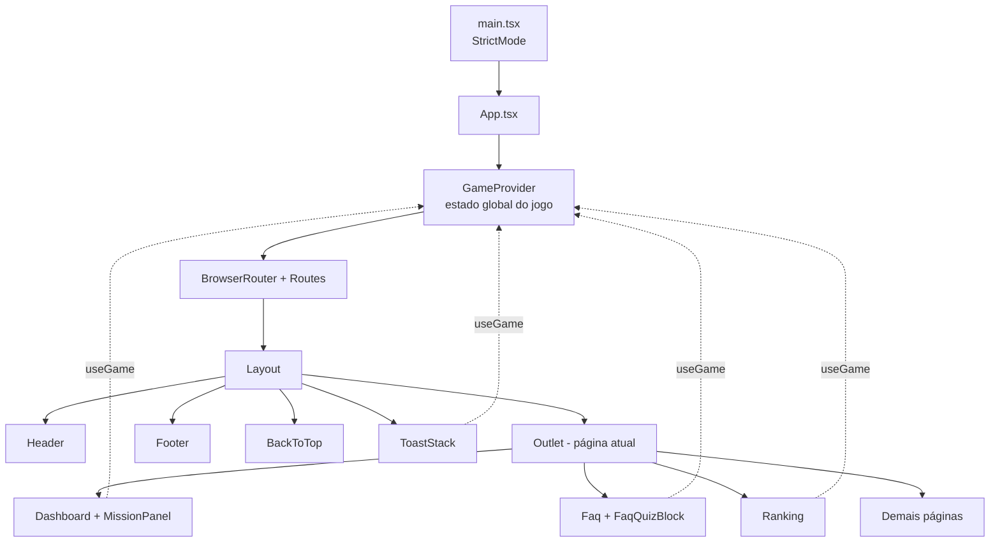

# 👻 SoulHunter - Caça de almas pelo transporte público


O **SoulHunter** é uma plataforma gamificada do ecossistema **SoulUp** que une entretenimento e mobilidade urbana: o jogador explora a cidade, cumpre missões sobre hábitos sustentáveis, "caça" almas (fantasmas colecionáveis) espalhadas pelas estações de metrô de São Paulo e troca seus pontos por passagens de transporte público.

Esta é a **Sprint 3** do projeto. Nela, o site deixou de ser um conjunto de páginas estáticas e virou uma **SPA (Single Page Application)** moderna: componentizada, tipada com TypeScript, com estado global, rotas dinâmicas, formulário validado, acessibilidade e identidade visual própria em tema noturno.

---

## 📑 Sumário

- [Prévia do projeto](#-prévia-do-projeto)
- [Funcionalidades](#-funcionalidades)
- [Como testar o jogo (passo a passo)](#-como-testar-o-jogo-passo-a-passo)
- [Tecnologias e ferramentas](#-tecnologias-e-ferramentas)
- [Arquitetura](#-arquitetura)
- [Estrutura de pastas](#-estrutura-de-pastas)
- [Rotas da aplicação](#-rotas-da-aplicação)
- [Sistema de pontos](#-sistema-de-pontos)
- [Estado global do jogo](#-estado-global-do-jogo)
- [Catálogo de componentes](#-catálogo-de-componentes)
- [Dados e tipos](#-dados-e-tipos)
- [Formulário de contato e validações](#-formulário-de-contato-e-validações)
- [Design, tema e responsividade](#-design-tema-e-responsividade)
- [Acessibilidade](#-acessibilidade)
- [Pré-requisitos](#-pré-requisitos)
- [Como executar localmente](#-como-executar-localmente)
- [Scripts disponíveis](#-scripts-disponíveis)
- [Build e deploy](#-build-e-deploy)
- [Solução de problemas](#-solução-de-problemas)
- [Escopo e limitações desta Sprint](#-escopo-e-limitações-desta-sprint)
- [Próximos passos](#-próximos-passos)
- [Equipe](#-equipe)

---

## 🖼 Prévia do projeto

| Home | Dashboard |
|---|---|
|  |  |

| Ranking | FAQ |
|---|---|
|  |  |

| Sobre | Integrantes |
|---|---|
|  |  |

**Versão mobile**


---

## ✨ Funcionalidades

### Jogo e gamificação
- 🎯 **Central de Missões:** 15 missões diárias sobre hábitos sustentáveis (reciclagem, transporte, água, energia e consumo consciente), cada uma valendo pontos.
- 🔎 **Pergunta do Dia:** uma pista sobre uma estação de metrô de São Paulo; acertar rende pontos extras.
- 🏆 **Ranking competitivo:** tabela com medalhas de ouro, prata e bronze que reordena em tempo real conforme o jogador pontua.
- 📊 **Dashboard:** pontuação, posição no ranking, missões completas e barra de progresso geral, tudo atualizado instantaneamente.
- ❓ **FAQ com mini quiz:** algumas perguntas trazem um quiz; acertando ou errando, o jogador ganha pontos.
- 🔔 **Notificações (toasts):** aviso visual a cada pontuação conquistada, com fechamento automático.
- 👤 **Nome de caçador(a):** o jogador escolhe como aparecer no ranking.

### Site institucional
- 🏠 **Home** com funcionalidades, "Como funciona", indicadores e galeria de almas.
- 👥 **Integrantes** com cards e **página de detalhe dinâmica** para cada membro da equipe (`/integrantes/:id`).
- 📖 **Sobre o projeto** com as almas colecionáveis.
- ✉️ **Contato** com formulário avançado: validação em tempo real, contador de caracteres, níveis de urgência com prazo de resposta e tela de confirmação.
- 🎮 **Página BETA do jogo** com QR code de acesso e exemplos de fantasmas encontrados.
- 🚧 **Página 404** personalizada e redirecionamento automático (após 2,5 s) para ids de integrantes inexistentes.
- 🥚 **Página-surpresa** (`/fantasma`), um easter egg com humor.

### Qualidade de interface
- 📱 **Responsivo** em três faixas: mobile, tablet e desktop.
- ♿ **Acessibilidade** com ARIA, foco visível e campos de formulário descritos para leitores de tela.
- 🌌 **Tema noturno** com cor de destaque própria para cada página.
- ⬆️ Botão **"voltar ao topo"** e título da aba do navegador atualizado em cada página.

---

## 🧪 Como testar o jogo (passo a passo)

Com o projeto rodando (veja [Como executar localmente](#-como-executar-localmente)):

1. Abra **`/dashboard`**. Tudo começa zerado, e a posição inicial no ranking é a última.
2. No painel **Central de Missões**, digite um nome de caçador(a) e clique em **Confirmar e começar a caçada**.
3. Na **Pergunta do Dia**, digite **`Sé`** e clique em **Investigar** para ganhar **+50 pontos**. Uma resposta sem relação com a estação mostra um aviso.
4. Responda as missões digitando qualquer texto no campo e clicando em **+30 pts**. Cada missão só pontua uma vez.
5. Veja a pontuação, o progresso e a posição mudarem na hora, e os avisos de pontos aparecerem na tela.
6. Abra **`/faq`**, expanda as perguntas que têm quiz e escolha uma opção (certa ou errada, ambas pontuam).
7. Abra **`/ranking`** e confira sua posição em destaque entre os jogadores de referência.
8. Abra **`/contato`** e teste as validações (nome com números, e-mail inválido, mensagem curta demais).
9. Abra **`/integrantes`**, clique em um membro e depois tente um endereço inexistente, como `/integrantes/teste`, para ver o redirecionamento.
10. Abra **`/soulhunter`** (menu **BETA**) para ver o QR code e os exemplos de fantasmas.

> O progresso do jogo fica **em memória**: ao recarregar a página, o jogo recomeça do zero.

---

## 🛠 Tecnologias e ferramentas

| Categoria | Tecnologia | Uso no projeto |
|---|---|---|
| Interface | [React 19](https://react.dev) | Componentes funcionais e Hooks |
| Linguagem | [TypeScript 6](https://www.typescriptlang.org) | Tipagem estática em toda a aplicação |
| Build | [Vite 8](https://vite.dev) | Servidor de desenvolvimento e build de produção |
| Estilização | [Tailwind CSS 4](https://tailwindcss.com) | Tema customizado, utilitários e responsividade (plugin `@tailwindcss/vite`) |
| Navegação | [React Router DOM 7](https://reactrouter.com) | Rotas estáticas, dinâmicas, layout compartilhado e 404 |
| Formulários | [React Hook Form 7](https://react-hook-form.com) | Formulário de contato com validação tipada |
| Ícones | [Lucide React](https://lucide.dev) | Ícones SVG em toda a interface |
| Qualidade | [ESLint](https://eslint.org) + typescript-eslint + plugins de React Hooks e Fast Refresh | Padronização e análise estática do código |
| Gerenciador | npm | Dependências e scripts |

---

## 🏗 Arquitetura



| Camada | Pasta / arquivo | Responsabilidade |
|---|---|---|
| **Entrada** | `main.tsx`, `App.tsx` | Monta a aplicação em `StrictMode` e define as rotas |
| **Estado global** | `context/GameContext.tsx` | Pontos, nome do jogador, missões respondidas e notificações (Context API + `useReducer`) |
| **Páginas** | `pages/*` | Uma pasta por tela; cada página compõe componentes e consome o estado |
| **Componentes** | `components/*` | Peças reutilizáveis de interface (botões, cards, formulário, fantasmas, layout) |
| **Dados** | `data/*` | Conteúdo do site e do jogo (missões, FAQ, ranking, almas, integrantes, contato) |
| **Tipos** | `types/index.ts` | Interfaces e tipos compartilhados pela aplicação |
| **Tema** | `theme/pageAccent.ts`, `index.css` | Paleta, gradientes por página, animações e classes utilitárias |
| **Hooks** | `hooks/useDocumentTitle.ts` | Hook próprio para o título da aba |

**Decisões técnicas**

- **Context API + `useReducer`:** as ações (`SET_USERNAME`, `AWARD_POINTS`, `DISMISS_TOAST`) passam por um *reducer* puro, o que deixa o fluxo previsível e impede pontuação duplicada.
- **Ranking derivado do estado:** `buildRanking` combina jogadores de referência com o jogador atual, reordena por pontos e recalcula as medalhas a cada mudança, sem guardar o ranking em lugar nenhum.
- **Dados separados da interface:** adicionar uma missão ou uma pergunta de FAQ não exige mexer nos componentes.
- **Tema por página:** cada rota tem cor, gradiente e selo próprios, aplicados no cabeçalho, no rodapé e nos destaques.

---

## 📂 Estrutura de pastas

```
soul_hunter_sprint3/
├── docs/screenshots/           # Capturas de tela usadas neste README
├── public/
│   └── favicon.svg
├── src/
│   ├── assets/img/             # Imagens: integrantes, almas, ícones e reciclagem
│   ├── components/             # Componentes reutilizáveis
│   │   ├── BackToTop/
│   │   ├── Button/             # Button e ButtonLink
│   │   ├── Card/
│   │   ├── CardFantasma/
│   │   ├── ExpandableCard/
│   │   ├── Footer/
│   │   ├── FormField/
│   │   ├── Ghost/              # Ghost e GhostField (fantasmas decorativos em SVG)
│   │   ├── Header/
│   │   ├── Layout/
│   │   └── ToastStack/
│   ├── context/
│   │   └── GameContext.tsx     # Estado global do jogo (Context + useReducer)
│   ├── data/                   # almas, contato, faq, integrantes, missoes, ranking
│   ├── hooks/
│   │   └── useDocumentTitle.ts
│   ├── pages/                  # Uma pasta por página
│   │   ├── Contato/
│   │   ├── Dashboard/          # Dashboard e MissionPanel
│   │   ├── Fantasma/
│   │   ├── Faq/                # Faq e FaqQuizBlock
│   │   ├── Home/
│   │   ├── IntegranteDetalhe/
│   │   ├── Integrantes/
│   │   ├── NotFound/
│   │   ├── Ranking/
│   │   ├── Sobre/
│   │   └── SoulHunter/
│   ├── theme/
│   │   └── pageAccent.ts       # Cores e gradientes por página
│   ├── types/
│   │   └── index.ts            # Interfaces e tipos compartilhados
│   ├── App.tsx                 # Definição das rotas
│   ├── index.css               # Tailwind + tema (cores soul-*)
│   └── main.tsx                # Ponto de entrada
├── eslint.config.js
├── index.html
├── package.json
├── tsconfig.app.json / tsconfig.node.json / tsconfig.json
└── vite.config.ts
```

---

## 🧭 Rotas da aplicação

| Rota | Página | Descrição |
|---|---|---|
| `/` | Home | Apresentação, funcionalidades e "Como funciona" |
| `/integrantes` | Integrantes | Lista dos membros da equipe |
| `/integrantes/:id` | Detalhe do integrante | Rota dinâmica com bio, links e fantasma favorito |
| `/sobre` | Sobre | Sobre o projeto e almas colecionáveis |
| `/faq` | FAQ | Perguntas frequentes com mini quiz que pontua |
| `/contato` | Contato | Formulário validado |
| `/dashboard` | Dashboard | Central de missões, pontuação e progresso |
| `/ranking` | Ranking | Tabela de classificação com medalhas |
| `/soulhunter` | BETA | QR code da versão beta e exemplos de fantasmas |
| `/fantasma` | ??? | Página-surpresa (easter egg) |
| `*` | 404 | Página não encontrada |

Todas as páginas ficam dentro de um **`Layout`** comum (cabeçalho, rodapé, botão de voltar ao topo e área de notificações).

**Ids válidos em `/integrantes/:id`:** `tarik-moussa-alma`, `giovanni-azevedo`, `italo-neto`, `fabricio-aquiles` e `carlos-tsucamoto`.

---

## 🎲 Sistema de pontos

| Origem | Pontos | Observação |
|---|---|---|
| Missões da Central (15) | 30 cada | Aceitam qualquer texto não vazio; pontuam uma única vez |
| Pergunta do Dia | 50 | Resposta esperada: estação **Sé** |
| Quiz do FAQ (4 quizzes) | 20, 20, 25 e 20 | Pontua ao responder, certo ou errado, uma vez por quiz |

**Pontuação máxima:** 450 (missões) + 50 (pergunta do dia) + 85 (quizzes) = **585 pontos**.

**Categorias das missões** (3 missões em cada): ♻️ reciclagem, 🚌 transporte, 💧 água, ⚡ energia e 🛍️ consumo consciente.

Cada conquista tem um identificador próprio, então **a mesma missão nunca pontua duas vezes**, mesmo em modo de desenvolvimento, em que o React executa funções duas vezes (`StrictMode`).

---

## 🧠 Estado global do jogo

Implementado em `src/context/GameContext.tsx` com **Context API + `useReducer`**.

**Estado**

| Campo | Tipo | Valor inicial | Descrição |
|---|---|---|---|
| `username` | `string` | `"Visitante"` | Nome exibido no ranking |
| `points` | `number` | `0` | Pontuação total |
| `answeredMissionIds` | `string[]` | `[]` | Ids das missões e quizzes já pontuados |
| `toasts` | `{ id, message }[]` | `[]` | Notificações de pontos ativas |

**Ações do reducer**

| Ação | O que faz |
|---|---|
| `SET_USERNAME` | Define o nome do jogador (nome vazio volta para "Visitante") |
| `AWARD_POINTS` | Soma pontos e registra a missão; se ela já foi respondida, não faz nada |
| `DISMISS_TOAST` | Remove uma notificação |

**API exposta pelo hook `useGame()`**

| Item | Descrição |
|---|---|
| `username`, `setUsername(nome)` | Lê e altera o nome do jogador |
| `points` | Pontuação atual |
| `missionsCompleted` | Quantidade de conquistas registradas |
| `answeredMissionIds` | Lista de ids já pontuados |
| `awardPoints(id, pontos, mensagem?)` | Concede pontos uma única vez por id |
| `toasts`, `dismissToast(id)` | Notificações e fechamento |

O hook lança um erro claro se for usado fora do `GameProvider`.

---

## 🧩 Catálogo de componentes

| Componente | Props principais | Descrição |
|---|---|---|
| `Layout` | n/a | Estrutura comum: `Header`, `Outlet`, `Footer`, `BackToTop` e `ToastStack` |
| `Header` | n/a | Navegação responsiva com menu móvel, item ativo e listra na cor da página |
| `Footer` | n/a | Rodapé com o selo da atmosfera da página atual |
| `Button` | `variant` (`solid`, `outline`, `ghost`), `className` e atributos de `<button>` | Botão padrão do design system |
| `ButtonLink` | `to`, `variant`, `className`, `ariaLabel` | Link de navegação com aparência de botão |
| `Card` | `glow`, `className` | Cartão com efeito "vidro" e brilho opcional |
| `ExpandableCard` | `icon`, `title`, `color`, `summary`, `more` | Cartão que expande para mostrar mais conteúdo |
| `CardFantasma` | `imagem`, `alt`, `nome` | Imagem de fantasma com legenda (página BETA) |
| `FormField` | `id`, `label`, `error`, `hint`, `required`, `valid`, `trailing`, `asGroup` | Envelope de campo: asterisco de obrigatório, dica, erro acessível e selo de campo válido |
| `Ghost` | `color`, `size`, `variant` (1 a 3), `className`, `style` | Fantasma em SVG com aura colorida |
| `GhostField` | `ghosts`, `className` | Camada decorativa de fantasmas flutuantes, sem interceptar cliques |
| `ToastStack` | n/a | Pilha de notificações de pontos, cada uma some após cerca de 3 s |
| `BackToTop` | n/a | Botão de voltar ao topo, visível depois de rolar 300 px |

**Componentes de página:** `MissionPanel` (Dashboard) e `FaqQuizBlock` (FAQ).

---

## 🗂 Dados e tipos

Todo o conteúdo fica em `src/data`, tipado por `src/types/index.ts`.

| Arquivo | Conteúdo |
|---|---|
| `missoes.ts` | 15 missões (pergunta, ícone, pontos e exemplo de resposta) |
| `faq.ts` | 6 perguntas, das quais 4 têm mini quiz (pergunta, opções, resposta correta e pontos) |
| `ranking.ts` | 7 jogadores de referência, ícones de medalha e a função `buildRanking` |
| `almas.ts` | 4 almas colecionáveis: Pura Alma, Lord Voldemetro, Passe-Man e James Bones |
| `integrantes.ts` | 5 membros: nome, foto, GitHub, LinkedIn, bio e fantasma favorito |
| `contato.ts` | Motivos de contato e níveis de urgência (cor, ícone, prazo e descrição) |

**Tipos principais:** `Integrante`, `FaqItem`, `RankingEntry`, `Medalha`, `Alma`, `MotivoContato`, `UrgenciaContato` e `ContatoFormData`.

---

## 📬 Formulário de contato e validações

Construído com **React Hook Form**, com validação ao sair de cada campo (`mode: "onTouched"`).

| Campo | Regras | Mensagem de exemplo |
|---|---|---|
| **Nome** | Obrigatório, de 3 a 60 caracteres, apenas letras e espaços | "Use apenas letras e espaços, sem números ou símbolos." |
| **E-mail** | Obrigatório, formato `nome@dominio.com` | "Esse e-mail não parece válido." |
| **Motivo** | Obrigatório (lista de assuntos) | "Selecione o motivo que melhor descreve seu contato." |
| **Urgência** | Obrigatória | "Escolha um nível de urgência para a mensagem." |
| **Mensagem** | Obrigatória, de 20 a 500 caracteres, com contador | "Faltam N caracteres para o mínimo de 20." |

**Motivos:** dúvida sobre o jogo, sugestão de melhoria, parceria ou patrocínio, reportar um bug e outro assunto.

**Níveis de urgência**

| Nível | Prazo exibido |
|---|---|
| Baixa | até 5 dias úteis |
| Média | até 3 dias úteis |
| Alta | até 24 horas |
| Urgente | no mesmo dia |

**Recursos extras:** selo de campo válido, indicador de progresso do preenchimento, cor de destaque que muda conforme a urgência, botão de limpar e tela de confirmação após o envio. O envio é **simulado localmente**, sem chamada a servidor.

---

## 🎨 Design, tema e responsividade

**Paleta (Tailwind `@theme`)**

| Token | Cor | Uso |
|---|---|---|
| `soul-950` a `soul-600` | `#040914` a `#155e75` | Fundos e superfícies do tema noturno |
| `soul-cyan` / `soul-cyan-soft` | `#22d3ee` / `#67e8f9` | Destaque principal |
| `soul-teal` | `#2dd4bf` | Sucesso e confirmações |
| `soul-violet` / `soul-violet-soft` | `#8b5cf6` / `#a78bfa` | Destaques secundários |
| `soul-magenta` | `#d946ef` | FAQ e páginas "sobrenaturais" |
| `soul-gold` | `#fbbf24` | Ranking, contato e medalhas |

**Efeitos próprios:** cartões de vidro (`glass-card`), texto neon (`neon-text`), fantasmas flutuantes e brilho pulsante, definidos em `index.css`.

**Responsividade**

| Faixa | Largura mínima |
|---|---|
| Mobile | a partir de 480 px |
| Tablet | a partir de 768 px |
| Desktop | a partir de 992 px |

---

## ♿ Acessibilidade

- Ícones decorativos com `aria-hidden`.
- Botões do menu e do "voltar ao topo" com `aria-label`.
- FAQ com `aria-expanded` nos itens.
- Barra de progresso com `role="progressbar"` e valores mínimo, máximo e atual.
- Campos de formulário ligados às dicas e mensagens de erro por `aria-describedby`, com `aria-invalid` nos erros.
- Foco visível nos botões e links.
- Título da aba atualizado a cada página (`useDocumentTitle`).

---

## 📋 Pré-requisitos

- **Node.js 20.19+ ou 22.12+** (exigência do Vite 8). Recomendado: a versão LTS mais recente. Baixe em [nodejs.org](https://nodejs.org).
- **npm**, que já vem com o Node.js.
- **Git**, para clonar o repositório.

Não é necessário banco de dados, variáveis de ambiente ou chaves de API: o projeto é um front-end que roda por inteiro no navegador.

---

## 🚀 Como executar localmente

```bash
# 1. Clone o repositório
git clone https://github.com/cearaa/soul_hunter_sprint3.git

# 2. Entre na pasta do projeto
cd soul_hunter_sprint3

# 3. Instale as dependências
npm install

# 4. Inicie o ambiente de desenvolvimento
npm run dev
```

Abra no navegador o endereço exibido no terminal (normalmente **http://localhost:5173**).

---

## 📜 Scripts disponíveis

| Comando | O que faz |
|---|---|
| `npm run dev` | Inicia o servidor de desenvolvimento com recarga automática |
| `npm run build` | Verifica os tipos com TypeScript e gera o build de produção na pasta `dist/` |
| `npm run preview` | Serve localmente o build de produção para conferência |
| `npm run lint` | Analisa o código com ESLint |

---

## 📦 Build e deploy

```bash
npm run build      # gera a pasta dist/
npm run preview    # confere o resultado localmente
```

Os arquivos finais ficam em `dist/` e podem ser hospedados em qualquer serviço de sites estáticos.

### Deploy no Render (Static Site)

1. Envie o projeto para o seu repositório no GitHub.
2. No [Render](https://render.com), clique em **New → Static Site** e conecte o repositório.
3. Configure:
   - **Build Command:** `npm install && npm run build`
   - **Publish Directory:** `dist`
4. Em **Redirects/Rewrites**, crie uma regra de **Rewrite** de `/*` para `/index.html`.
5. Clique em **Create Static Site** e aguarde o build.

> **Por que a regra de rewrite?** O projeto usa `BrowserRouter`. Sem ela, abrir diretamente um endereço como `/ranking` ou recarregar a página em uma rota interna resulta em erro 404 do servidor. O mesmo vale para Vercel, Netlify e outros serviços, que têm configuração equivalente.

---

## 🩺 Solução de problemas

| Problema | Causa provável | Solução |
|---|---|---|
| `npm install` falha ou avisa sobre versão do Node | Node.js desatualizado | Instale o Node 20.19+ ou 22.12+ e rode `npm install` de novo |
| `npm run dev` diz que a porta 5173 está em uso | Outro processo usando a porta | Feche o outro processo ou use `npm run dev -- --port 3000` |
| Tela em branco depois do deploy | Falta o rewrite para `index.html` ou o diretório de publicação está errado | Confira `dist` como diretório de publicação e a regra de rewrite |
| Erro 404 ao recarregar uma rota no site publicado | Falta o rewrite para `index.html` | Crie a regra `/*` → `/index.html` |
| A pontuação some ao atualizar a página | O progresso é guardado só em memória | Comportamento esperado nesta Sprint (veja as limitações abaixo) |
| Imagens dos fantasmas da página BETA não aparecem | Elas são carregadas de links externos e dependem de internet | Verifique a conexão com a internet |

---

## ⚠️ Escopo e limitações desta Sprint

Para deixar claro o que o projeto entrega nesta etapa:

- **Sem back-end:** não há API nem banco de dados. O progresso do jogo vive em memória e **reinicia ao recarregar a página**.
- **Ranking:** os jogadores de referência são fixos e servem para dar contexto competitivo. Apenas o jogador atual entra de forma dinâmica.
- **Missões:** a validação aceita qualquer texto não vazio, com o objetivo de demonstrar o funcionamento do sistema de gamificação.
- **Formulário de contato:** o envio é **simulado localmente** (nenhuma mensagem é enviada a um servidor).
- **Indicadores da Home** (caçadores ativos, missões concluídas etc.): valores ilustrativos de apresentação.
- **Versão BETA do jogo:** acessada por QR code na página `/soulhunter`, é uma etapa externa a este repositório, e o aviso na própria página informa que ela ainda tem bugs em correção.

---

## 🔭 Próximos passos

- [ ] Back-end com API para salvar pontos, missões e ranking de verdade
- [ ] Autenticação e perfil de jogador
- [ ] Persistência do progresso (por exemplo, `localStorage` como primeira etapa)
- [ ] Ranking real com dados de todos os jogadores
- [ ] Envio real do formulário de contato
- [ ] Testes automatizados (componentes e regras de pontuação)
- [ ] Integração com mapa e estações reais para a caça de almas
- [ ] Conversão de pontos em passagens de transporte público

---

## 👥 Equipe

Projeto desenvolvido em grupo na **FIAP** (curso de Análise e Desenvolvimento de Sistemas).

| Integrante | Contribuição | Links |
|---|---|---|
| **Tárik Moussa Alma** | Arquitetura de componentes, integração das páginas migradas para React e nova identidade visual noturna | [GitHub](https://github.com/cearaa) · [LinkedIn](https://www.linkedin.com/in/rikk-alma) |
| **Giovanni Azevedo** | Estilização com Tailwind CSS e responsividade (mobile, tablet e desktop) | [GitHub](https://github.com/GiovanniDEVazevedo) · [LinkedIn](https://www.linkedin.com/in/giovanni-azevedo-760753353/) |
| **Italo Neto** | Navegação com React Router, rotas dinâmicas e sistema de missões do Dashboard | [GitHub](https://github.com/I-neeto99) · [LinkedIn](https://www.linkedin.com/in/italo-neto-390579345/) |
| **Fabrício Aquiles Sales da Silva** | Formulário de contato com React Hook Form e validações tipadas em TypeScript | [GitHub](https://github.com/fabricioaquiles) · [LinkedIn](https://www.linkedin.com/in/fabricioaquiles/) |
| **Carlos Eduardo Tsucamoto Chiarelli** | Organização do projeto em componentes reutilizáveis e pastas | [GitHub](https://github.com/carlostsucamoto) · [LinkedIn](https://www.linkedin.com/in/carlostsucamoto/) |

[](https://github.com/cearaa)
[](https://www.linkedin.com/in/rikk-alma/)
[](https://github.com/cearaa/soul_hunter_sprint3)
