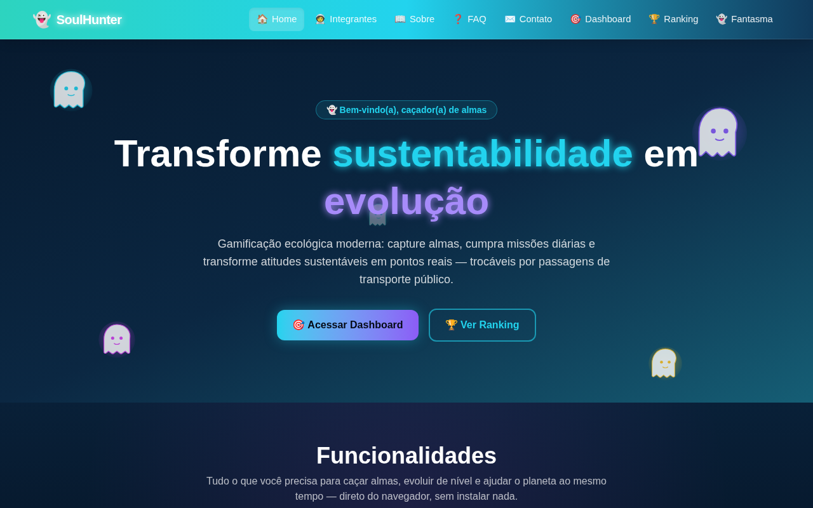
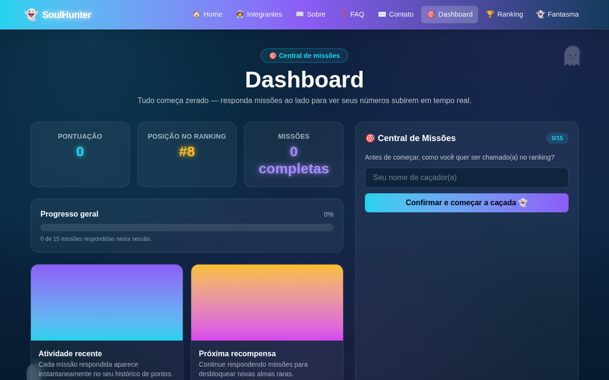
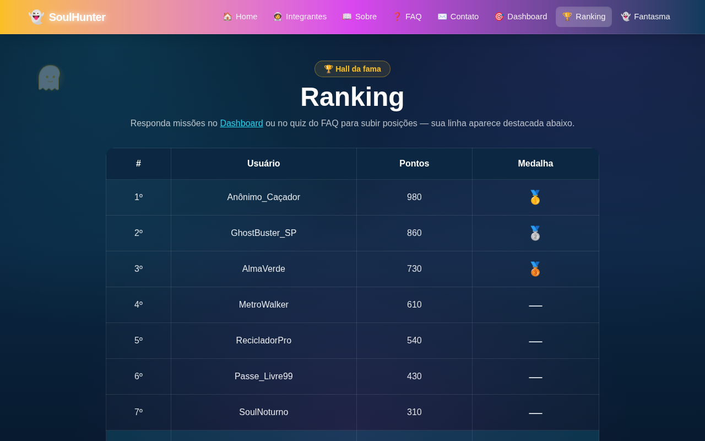
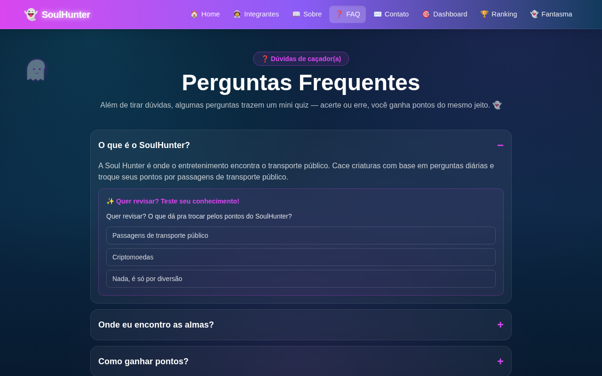
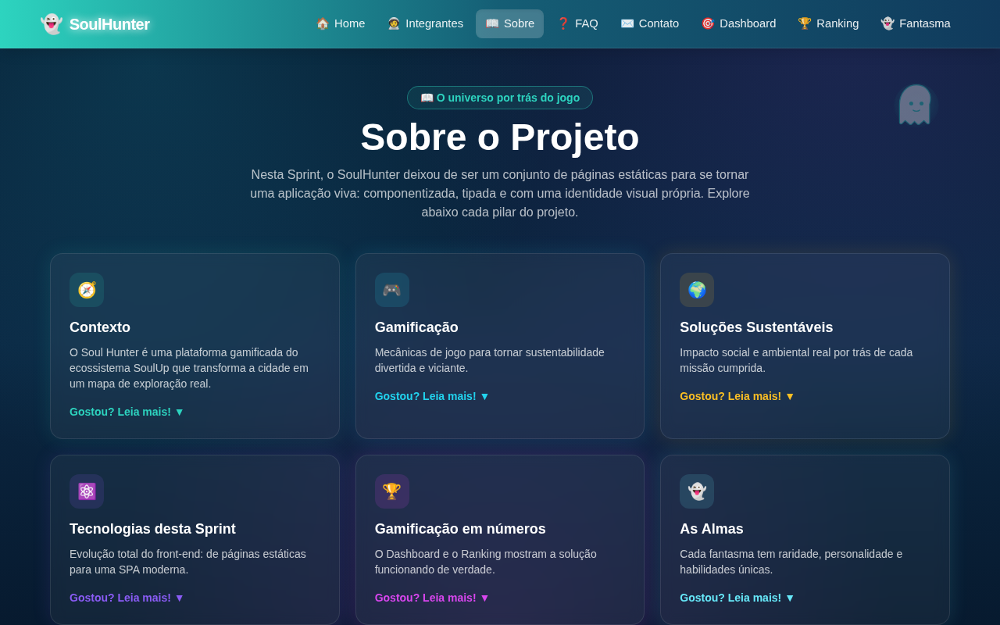
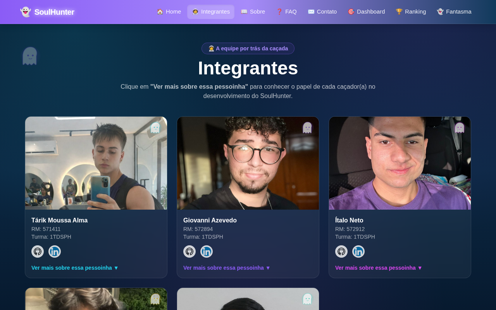
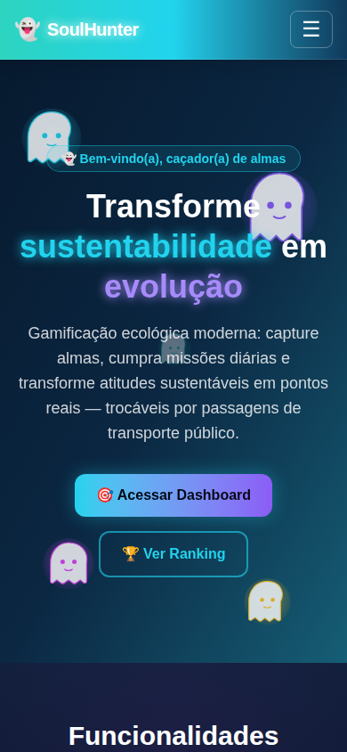
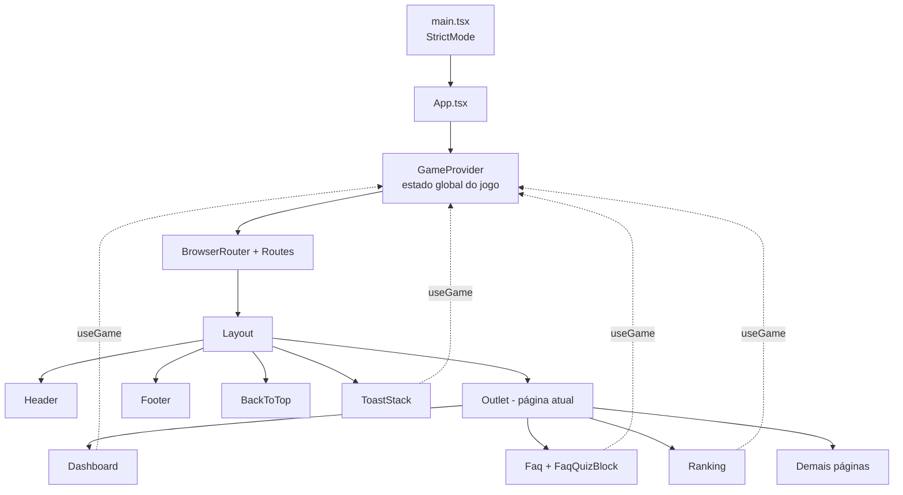

# 👻 SoulHunter - Caça de almas pelo transporte público


O **SoulHunter** é uma plataforma gamificada do ecossistema **SoulUp** que une entretenimento e mobilidade urbana: o jogador explora a cidade, cumpre missões sobre hábitos sustentáveis, "caça" almas (fantasmas colecionáveis) espalhadas pelas estações de metrô de São Paulo e troca seus pontos por passagens de transporte público.

Esta é a **Sprint 3** do projeto, em que o site deixou de ser um conjunto de páginas estáticas e virou uma **SPA (Single Page Application)** moderna: componentizada, tipada com TypeScript, com estado global, rotas dinâmicas, formulário validado e identidade visual própria em tema noturno.

---

## 📑 Sumário

- [Prévia do projeto](#-prévia-do-projeto)
- [Funcionalidades](#-funcionalidades)
- [Como testar o jogo (passo a passo)](#-como-testar-o-jogo-passo-a-passo)
- [Tecnologias](#-tecnologias)
- [Rotas da aplicação](#-rotas-da-aplicação)
- [Sistema de pontos](#-sistema-de-pontos)
- [Arquitetura e decisões técnicas](#-arquitetura-e-decisões-técnicas)
- [Estrutura de pastas](#-estrutura-de-pastas)
- [Pré-requisitos](#-pré-requisitos)
- [Como executar localmente](#-como-executar-localmente)
- [Scripts disponíveis](#-scripts-disponíveis)
- [Publicação (build de produção)](#-publicação-build-de-produção)
- [Escopo e limitações desta Sprint](#-escopo-e-limitações-desta-sprint)
- [Próximos passos](#-próximos-passos)
- [Equipe](#-equipe)

---

## 🖼 Prévia do projeto

| Home | Dashboard |
|---|---|
|  |  |

| Ranking | FAQ |
|---|---|
|  |  |

| Sobre | Integrantes |
|---|---|
|  |  |

**Versão mobile**



---

## ✨ Funcionalidades

### Jogo e gamificação
- 🎯 **Central de Missões:** 15 missões diárias sobre hábitos sustentáveis (reciclagem, transporte, água, energia e consumo consciente), cada uma valendo pontos.
- 🔎 **Pergunta do Dia:** uma pista sobre uma estação de metrô de São Paulo; acertar rende pontos extras.
- 🏆 **Ranking competitivo:** tabela com medalhas de ouro, prata e bronze que reordena em tempo real conforme o jogador pontua.
- 📊 **Dashboard:** pontuação, posição no ranking, missões completas e barra de progresso geral, tudo atualizado instantaneamente.
- ❓ **FAQ com mini quiz:** algumas perguntas trazem um quiz; acertando ou errando, o jogador ganha pontos.
- 🔔 **Notificações (toasts):** aviso visual a cada pontuação conquistada.
- 👤 **Nome de caçador(a):** o jogador escolhe como aparecer no ranking.

### Site institucional
- 🏠 **Home** com funcionalidades, "Como funciona" e galeria de almas.
- 👥 **Integrantes** com cards e **página de detalhe dinâmica** para cada membro da equipe (`/integrantes/:id`).
- 📖 **Sobre o projeto** com as almas colecionáveis.
- ✉️ **Contato** com formulário avançado: validação em tempo real, contador de caracteres, níveis de urgência com prazo de resposta e tela de confirmação.
- 🎮 **Página BETA do jogo** com QR code de acesso e exemplos de fantasmas encontrados.
- 🚧 **Página 404** personalizada e redirecionamento automático para ids de integrantes inexistentes.
- 🥚 **Página-surpresa** (`/fantasma`), um easter egg com humor.

### Qualidade de interface
- 📱 **Responsivo** em três faixas (mobile, tablet e desktop).
- ♿ **Acessibilidade:** rótulos ARIA, `aria-describedby` nos campos de formulário, `aria-expanded` no FAQ e barra de progresso com `role="progressbar"`.
- 🌌 **Tema noturno** com cor de destaque própria para cada página.
- ⬆️ Botão **"voltar ao topo"** e título da aba do navegador atualizado em cada página.

---

## 🧪 Como testar o jogo (passo a passo)

Com o projeto rodando (veja [Como executar localmente](#-como-executar-localmente)):

1. Abra **`/dashboard`**. Tudo começa zerado, e a posição inicial no ranking é a última.
2. No painel **Central de Missões**, digite um nome de caçador(a) e clique em **Confirmar e começar a caçada**.
3. Na **Pergunta do Dia**, digite **`Sé`** e clique em **Investigar** para ganhar **+50 pontos**. Uma resposta sem relação com a estação mostra um aviso.
4. Responda as missões digitando qualquer texto no campo e clicando em **+30 pts**. Cada missão só pontua uma vez.
5. Veja a pontuação, o progresso e a posição mudarem na hora, e os avisos de pontos aparecerem na tela.
6. Abra **`/faq`**, expanda as perguntas que têm quiz e escolha uma opção (certa ou errada, ambas pontuam).
7. Abra **`/ranking`** e confira sua posição em destaque entre os jogadores de referência.
8. Abra **`/contato`** e teste as validações (nome com números, e-mail inválido, mensagem curta demais).
9. Abra **`/integrantes`**, clique em um membro e depois tente um endereço inexistente, como `/integrantes/teste`, para ver o redirecionamento.
10. Abra **`/soulhunter`** (menu **BETA**) para ver o QR code e os exemplos de fantasmas.

> O progresso do jogo fica **em memória**: ao recarregar a página, o jogo recomeça do zero.

---

## 🛠 Tecnologias

| Tecnologia | Uso no projeto |
|---|---|
| [React 19](https://react.dev) | Biblioteca de interface (componentes funcionais e Hooks) |
| [TypeScript 6](https://www.typescriptlang.org) | Tipagem estática em toda a aplicação |
| [Vite 8](https://vite.dev) | Servidor de desenvolvimento e build |
| [Tailwind CSS 4](https://tailwindcss.com) | Estilização, tema customizado e responsividade |
| [React Router DOM 7](https://reactrouter.com) | Rotas estáticas, rotas dinâmicas e layout compartilhado |
| [React Hook Form 7](https://react-hook-form.com) | Formulário de contato com validação tipada |
| [Lucide React](https://lucide.dev) | Ícones |
| [ESLint](https://eslint.org) + typescript-eslint | Padronização e análise do código |

---

## 🧭 Rotas da aplicação

| Rota | Página | Descrição |
|---|---|---|
| `/` | Home | Apresentação, funcionalidades e "Como funciona" |
| `/integrantes` | Integrantes | Lista dos membros da equipe |
| `/integrantes/:id` | Detalhe do integrante | Rota dinâmica com bio, links e fantasma favorito |
| `/sobre` | Sobre | Sobre o projeto e almas colecionáveis |
| `/faq` | FAQ | Perguntas frequentes com mini quiz que pontua |
| `/contato` | Contato | Formulário validado |
| `/dashboard` | Dashboard | Central de missões, pontuação e progresso |
| `/ranking` | Ranking | Tabela de classificação com medalhas |
| `/soulhunter` | BETA | QR code da versão beta e exemplos de fantasmas |
| `/fantasma` | ??? | Página-surpresa (easter egg) |
| `*` | 404 | Página não encontrada |

Todas as páginas ficam dentro de um **`Layout`** comum (cabeçalho, rodapé, botão de voltar ao topo e área de notificações).

---

## 🎲 Sistema de pontos

| Origem | Pontos | Observação |
|---|---|---|
| Missões da Central (15) | 30 cada | Aceitam qualquer texto não vazio; pontuam uma única vez |
| Pergunta do Dia | 50 | Resposta esperada: estação **Sé** |
| Quiz do FAQ (4 quizzes) | 20, 20, 25 e 20 | Pontua ao responder, certo ou errado, uma vez por quiz |

**Pontuação máxima:** 450 (missões) + 50 (pergunta do dia) + 85 (quizzes) = **585 pontos**.

Cada conquista tem um identificador próprio, então **a mesma missão nunca pontua duas vezes**, mesmo em modo de desenvolvimento, em que o React executa funções duas vezes (`StrictMode`).

---

## 🏗 Arquitetura e decisões técnicas



**Principais decisões**

- **Estado global com Context API + `useReducer`:** o `GameContext` guarda nome do jogador, pontos, missões respondidas e notificações. As ações (`SET_USERNAME`, `AWARD_POINTS`, `DISMISS_TOAST`) passam por um *reducer* puro, o que torna o fluxo previsível e evita pontuação duplicada.
- **Ranking derivado do estado:** a função `buildRanking` combina jogadores de referência com o jogador atual, reordena por pontos e recalcula as medalhas a cada mudança, sem guardar o ranking em lugar nenhum.
- **Dados separados da interface:** missões, FAQ, ranking, almas, integrantes e opções do formulário ficam em `src/data`, tipados por interfaces em `src/types`. Adicionar uma missão ou uma pergunta do FAQ não exige mexer nos componentes.
- **Componentização:** componentes reutilizáveis (`Button`, `ButtonLink`, `Card`, `ExpandableCard`, `FormField`, `Ghost`, `ToastStack`, entre outros) mantêm o visual consistente em todas as páginas.
- **Tema por página:** `pageAccent.ts` define cores e gradientes de cada rota, aplicados no cabeçalho, no rodapé e nos destaques.
- **Hook próprio:** `useDocumentTitle` atualiza o título da aba em cada página.
- **Formulário de contato validado:** nome (3 a 60 caracteres, só letras e espaços), e-mail em formato válido, motivo, urgência (baixa, média, alta ou urgente, cada uma com prazo estimado) e mensagem (20 a 500 caracteres, com contador). A validação ocorre ao sair de cada campo (`onTouched`), com selo de campo válido e indicador de progresso do preenchimento.

---

## 📂 Estrutura de pastas

```
soul_hunter_sprint3/
├── docs/screenshots/           # Capturas de tela usadas neste README
├── public/
│   └── favicon.svg
├── src/
│   ├── assets/img/             # Imagens: integrantes, almas, ícones e reciclagem
│   ├── components/             # Componentes reutilizáveis
│   │   ├── BackToTop/
│   │   ├── Button/             # Button e ButtonLink
│   │   ├── Card/
│   │   ├── CardFantasma/
│   │   ├── ExpandableCard/
│   │   ├── Footer/
│   │   ├── FormField/
│   │   ├── Ghost/              # Ghost e GhostField (fantasmas decorativos em SVG)
│   │   ├── Header/
│   │   ├── Layout/
│   │   └── ToastStack/
│   ├── context/
│   │   └── GameContext.tsx     # Estado global do jogo (Context + useReducer)
│   ├── data/                   # almas, contato, faq, integrantes, missoes, ranking
│   ├── hooks/
│   │   └── useDocumentTitle.ts
│   ├── pages/                  # Uma pasta por página
│   │   ├── Contato/
│   │   ├── Dashboard/          # Dashboard e MissionPanel
│   │   ├── Fantasma/
│   │   ├── Faq/                # Faq e FaqQuizBlock
│   │   ├── Home/
│   │   ├── IntegranteDetalhe/
│   │   ├── Integrantes/
│   │   ├── NotFound/
│   │   ├── Ranking/
│   │   ├── Sobre/
│   │   └── SoulHunter/
│   ├── theme/
│   │   └── pageAccent.ts       # Cores e gradientes por página
│   ├── types/
│   │   └── index.ts            # Interfaces e tipos compartilhados
│   ├── App.tsx                 # Definição das rotas
│   ├── index.css               # Tailwind + tema (cores soul-*)
│   └── main.tsx                # Ponto de entrada
├── eslint.config.js
├── index.html
├── package.json
├── tsconfig.app.json / tsconfig.node.json / tsconfig.json
└── vite.config.ts
```

---

## 📋 Pré-requisitos

- **Node.js 20.19+ ou 22.12+** (exigência do Vite 8). Recomendado: a versão LTS mais recente. Baixe em [nodejs.org](https://nodejs.org).
- **npm**, que já vem com o Node.js.
- **Git**, para clonar o repositório.

Não é necessário banco de dados, variáveis de ambiente ou chaves de API: o projeto é um front-end que roda por inteiro no navegador.

---

## 🚀 Como executar localmente

```bash
# 1. Clone o repositório
git clone https://github.com/cearaa/soul_hunter_sprint3.git

# 2. Entre na pasta do projeto
cd soul_hunter_sprint3

# 3. Instale as dependências
npm install

# 4. Inicie o ambiente de desenvolvimento
npm run dev
```

Abra no navegador o endereço exibido no terminal (normalmente **http://localhost:5173**).

---

## 📜 Scripts disponíveis

| Comando | O que faz |
|---|---|
| `npm run dev` | Inicia o servidor de desenvolvimento com recarga automática |
| `npm run build` | Verifica os tipos com TypeScript e gera o build de produção na pasta `dist/` |
| `npm run preview` | Serve localmente o build de produção para conferência |
| `npm run lint` | Analisa o código com ESLint |

---

## 📦 Publicação (build de produção)

```bash
npm run build
```

Os arquivos finais são gerados em `dist/` e podem ser hospedados em qualquer serviço de sites estáticos (Render Static Site, Vercel, Netlify, GitHub Pages, entre outros).

Como o projeto usa `BrowserRouter`, configure no serviço de hospedagem uma **regra de redirecionamento (rewrite) de todas as rotas para `/index.html`**. Sem isso, abrir diretamente um endereço como `/ranking` ou recarregar a página em uma rota interna resulta em erro 404 do servidor.

---

## ⚠️ Escopo e limitações desta Sprint

Para deixar claro o que o projeto entrega nesta etapa:

- **Sem back-end:** não há API nem banco de dados. O progresso do jogo vive em memória e **reinicia ao recarregar a página**.
- **Ranking:** os jogadores de referência são fixos e servem para dar contexto competitivo. Apenas o jogador atual entra de forma dinâmica.
- **Missões:** a validação aceita qualquer texto não vazio, com o objetivo de demonstrar o funcionamento do sistema de gamificação.
- **Formulário de contato:** o envio é **simulado localmente** (nenhuma mensagem é enviada a um servidor).
- **Indicadores da Home** (caçadores ativos, missões concluídas etc.): valores ilustrativos de apresentação.
- **Versão BETA do jogo:** acessada por QR code na página `/soulhunter`, é uma etapa externa a este repositório, e o aviso na própria página informa que ela ainda tem bugs em correção.

---

## 🔭 Próximos passos

- [ ] Back-end com API para salvar pontos, missões e ranking de verdade
- [ ] Autenticação e perfil de jogador
- [ ] Persistência do progresso (por exemplo, `localStorage` como primeira etapa)
- [ ] Ranking real com dados de todos os jogadores
- [ ] Envio real do formulário de contato
- [ ] Testes automatizados (componentes e regras de pontuação)
- [ ] Integração com mapa e estações reais para a caça de almas
- [ ] Conversão de pontos em passagens de transporte público

---

## 👥 Equipe

Projeto desenvolvido em grupo na **FIAP** (curso de Análise e Desenvolvimento de Sistemas).

| Integrante | Contribuição | Links |
|---|---|---|
| **Tárik Moussa Alma** | Arquitetura de componentes, integração das páginas migradas para React e nova identidade visual noturna | [GitHub](https://github.com/cearaa) · [LinkedIn](https://www.linkedin.com/in/rikk-alma) |
| **Giovanni Azevedo** | Estilização com Tailwind CSS e responsividade (mobile, tablet e desktop) | [GitHub](https://github.com/GiovanniDEVazevedo) · [LinkedIn](https://www.linkedin.com/in/giovanni-azevedo-760753353/) |
| **Italo Neto** | Navegação com React Router, rotas dinâmicas e sistema de missões do Dashboard | [GitHub](https://github.com/I-neeto99) · [LinkedIn](https://www.linkedin.com/in/italo-neto-390579345/) |
| **Fabrício Aquiles Sales da Silva** | Formulário de contato com React Hook Form e validações tipadas em TypeScript | [GitHub](https://github.com/fabricioaquiles) · [LinkedIn](https://www.linkedin.com/in/fabricioaquiles/) |
| **Carlos Eduardo Tsucamoto Chiarelli** | Organização do projeto em componentes reutilizáveis e pastas | [GitHub](https://github.com/carlostsucamoto) · [LinkedIn](https://www.linkedin.com/in/carlostsucamoto/) |

Repositório: [github.com/cearaa/soul_hunter_sprint3](https://github.com/cearaa/soul_hunter_sprint3)
